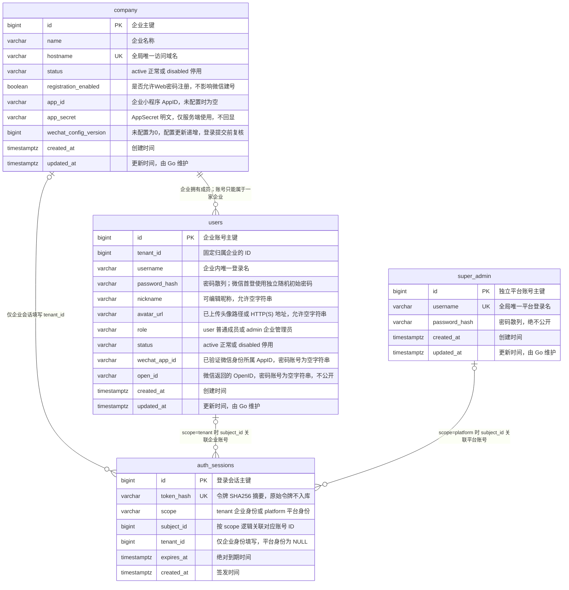

# SaaS 数据库

`saas.sql` 是 PostgreSQL 16+ 的完整建表文件，只包含当前 SaaS 的四张表。所有表和字段都有中文数据库注释；SQL 不写入账号或密码。

| 表 | 用途 |
| --- | --- |
| `company` | 企业名称、访问域名、状态、Web 注册开关，以及本企业 AppID、明文 AppSecret 和微信配置版本 |
| `users` | 固定归属一家企业的成员及企业管理员；微信 AppID 与 OpenID 直接保存在用户行中 |
| `super_admin` | 独立于企业的平台主管理账号 |
| `auth_sessions` | 企业和平台两种身份的登录会话及访问令牌摘要 |

## 数据关系

图中连线只说明逻辑关联，不代表数据库外键。企业成员通过 `users.tenant_id` 归属企业；登录会话的 `scope` 决定 `subject_id` 关联哪种账号，不能同时关联两种身份。平台会话的 `tenant_id` 为 NULL。

物理表名使用 `company`，业务中的 tenant 仍表示企业租户；现有 `tenant_id` 字段逻辑关联 `company.id`，HTTP 路径与 DTO 继续沿用 tenant 名称。



## 初始化

在空业务数据库中执行一次，在项目根目录运行：

```powershell
psql -X --set=ON_ERROR_STOP=1 --dbname=agent --file=.\db\saas.sql
```

SQL 在事务中创建 `public` 下的四张表，失败整批回滚。同名表已经存在时会报错，不通过 `IF NOT EXISTS` 掩盖结构不一致。首个平台管理员使用后端的 `go run ./cmd/api bootstrap` 显式初始化到 `super_admin`，见 [服务端说明](../server/README.md)。

## 索引与业务约束

- 企业域名、平台登录名全局唯一；企业登录名按 `(tenant_id, username)` 唯一。
- 用户行上的微信身份按 `(tenant_id, wechat_app_id, open_id)` 唯一；唯一索引仅覆盖 `wechat_app_id` 和 `open_id` 均非空字符串的行，普通密码账号两项均为空字符串。首次登录直接原子创建带微信身份的普通成员和企业会话，之后复用同一账号。Web 自主注册开关不影响微信建号，停用账号或企业均禁止登录。
- 微信首次创建的成员使用随机公开登录名和每账号独立的随机初始密码，数据库只保存 bcrypt 散列。小程序设置页通过新微信 code 验证同一用户后设置新密码；复登不会重置密码。AppSecret 直接明文保存在 `company.app_secret`，接口和日志均不返回密钥；`session_key` 不入库、不下发。
- `company.app_id / app_secret` 未配置时为空字符串，`wechat_config_version` 初始为 0，配置更新时递增。配置保存后运行时读取；登录时在微信外部验证前读取快照，写入账号与会话前再次校验租户和配置版本。企业改域名保留配置；更换 AppID 必须提供新 AppSecret，不自动合并不同小程序的微信身份。
- 成员索引支持企业内按创建时间分页；登录会话索引支持按主体、企业撤销和按到期时间清理。
- 主键及逻辑关联 ID 使用 `BIGINT`；公开 API 中 ID 使用十进制字符串，避免客户端精度丢失。
- `updated_at` 的默认值仅在插入时生效，后续由 Go 显式更新。登录会话只记录创建和到期时间，撤销直接删除。
- 表之间没有数据库外键、CHECK、数据库枚举、触发器或 RLS。企业归属、状态、角色、至少一名有效企业管理员及会话撤销均由 Go 在事务中维护，不能信任客户端传来的企业或账号归属。

当前业务和接口见 [SaaS 说明](../docs/saas.md)。
