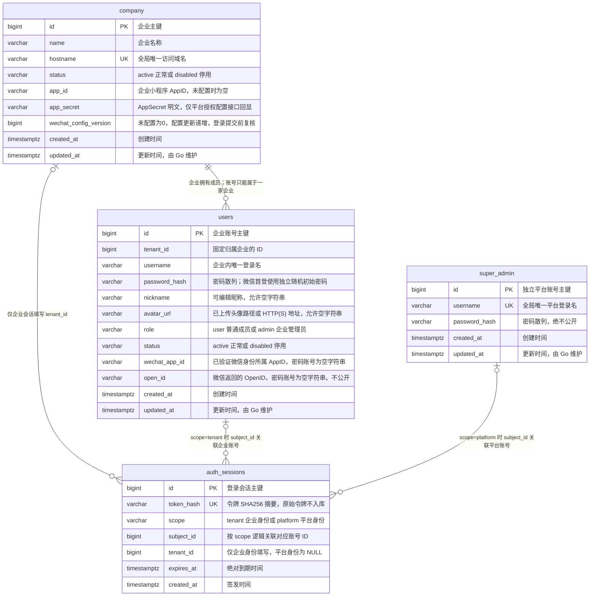
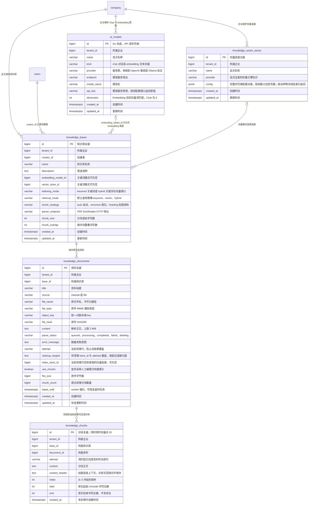
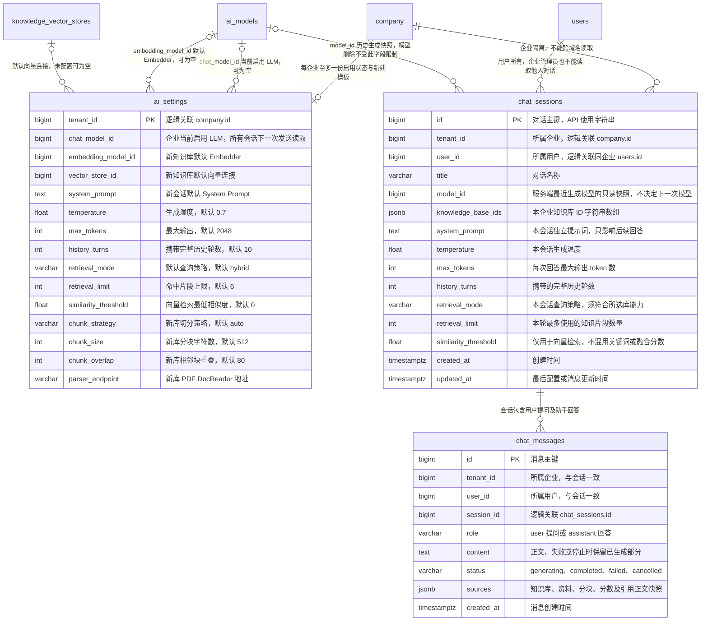

# SaaS 数据库

`saas.sql` 是 PostgreSQL 16+ 的唯一完整建表文件，包含 SaaS、AI 配置、文档知识库和聊天共十二张表。所有表和字段都有中文数据库注释；SQL 不写入账号或密码。

| 表 | 用途 |
| --- | --- |
| `company` | 企业名称、访问域名、状态，以及本企业 AppID、明文 AppSecret 和微信配置版本 |
| `users` | 固定归属一家企业的成员及企业管理员；微信 AppID 与 OpenID 直接保存在用户行中 |
| `super_admin` | 独立于企业的平台主管理账号 |
| `auth_sessions` | 企业和平台两种身份的登录会话及访问令牌摘要 |
| `ai_models` | 企业页面配置的 Chat / Embedding 模型与服务端密钥 |
| `ai_settings` | 企业当前启用 LLM，以及新建知识库和聊天会话使用的默认模板 |
| `knowledge_vector_stores` | 企业页面配置的向量引擎与通用配置，注册模块声明字段与实际驱动 |
| `knowledge_bases` | 知识库及检索、分块、解析配置 |
| `knowledge_documents` | 资料原件引用、正文、处理状态、任务租约和处理代 |
| `knowledge_chunks` | 已处理分块、字符位置及当前索引版本 |
| `chat_sessions` | 按企业和用户隔离的聊天会话与独立配置 |
| `chat_messages` | 消息、生成状态和本次回答的来源快照 |

## 数据关系

图中连线只说明逻辑关联，不代表数据库外键。企业成员通过 `users.tenant_id` 归属企业；登录会话的 `scope` 决定 `subject_id` 关联哪种账号，不能同时关联两种身份。平台会话的 `tenant_id` 为 NULL。

物理表名使用 `company`，业务中的 tenant 仍表示企业租户；现有 `tenant_id` 字段逻辑关联 `company.id`，HTTP 路径与 DTO 继续沿用 tenant 名称。



## 初始化

在空业务数据库中执行一次，在项目根目录运行：

```powershell
psql -X --set=ON_ERROR_STOP=1 --dbname=agent --file=.\db\saas.sql
```

SQL 在事务中创建 `public` 下的十二张表，失败整批回滚。同名表已经存在时会报错，不通过 `IF NOT EXISTS` 掩盖结构不一致。首个平台管理员使用后端的 `go run ./cmd/api bootstrap` 显式初始化到 `super_admin`，见 [服务端说明](../server/README.md)。

已有业务数据库应先核对现有结构，再显式执行与目标结构对应的 DDL；完整 SQL 只用于空库初始化。应用不执行 AutoMigrate，不自动重导、清空数据或备份。模型配置统一使用 `ai_models`，处理旧开发库时同时保留已有模型 ID 和相关引用，不能直接把整段新增表 SQL 当作通用迁移脚本。

## 知识库数据关系

以下仍是逻辑关联。`tenant_id` 明确每行的所属企业，便于按企业限定读取、处理和清理；并不由前端指定。分块与向量都需验证其企业、知识库、资料和处理代，避免单凭 ID 返回过时内容。



## 企业启用模型、默认模板与聊天关系

`auth_sessions` 是登录身份会话，`chat_sessions` 是用户对话，两者职责不同。Prompt、生成、检索及知识库处理参数只在创建时复制，修改模板不会修改已有对象。`ai_settings.chat_model_id` 则是企业唯一启用 LLM，每个新旧会话在下一次发送时重新读取；正在流式的请求使用开始时捕获的完整模型。`chat_sessions.model_id` 只由服务端记录最近生成模型快照，不作为客户端可写配置，也不锁定旧模型删除。消息保存引用内容快照，后续资料编辑、重建或删除不会改写历史引用。



## 索引与业务约束

- 企业域名、平台登录名全局唯一；企业登录名按 `(tenant_id, username)` 唯一。
- 用户行上的微信身份按 `(tenant_id, wechat_app_id, open_id)` 唯一；唯一索引仅覆盖 `wechat_app_id` 和 `open_id` 均非空字符串的行，普通密码账号两项均为空字符串。首次登录直接原子创建带微信身份的普通成员和企业会话，之后复用同一账号。Web 只提供账号密码登录，成员账号由管理员创建；停用账号或企业均禁止登录。
- 微信首次创建的成员使用随机公开登录名和每账号独立的随机初始密码，数据库只保存 bcrypt 散列。小程序设置页通过新微信 code 验证同一用户后设置新密码；复登不会重置密码。AppSecret 直接明文保存在 `company.app_secret`，仅平台授权配置接口返回原值；不进入公共站点、账号或微信登录响应及日志。微信临时 `session_key` 不入库、不下发。
- `company.app_id / app_secret` 未配置时为空字符串，`wechat_config_version` 初始为 0，配置更新时递增。保存完整提交两项有效值，不继承旧值，空值拒绝；配置保存后运行时读取。登录时在微信外部验证前读取快照，写入账号与会话前再次校验租户和配置版本。企业改域名保留配置，微信身份按 AppID 区分，不自动合并不同小程序的身份。
- 成员索引支持企业内按创建时间分页；登录会话索引支持按主体、企业撤销和按到期时间清理。
- 主键及逻辑关联 ID 使用 `BIGINT`；公开 API 中 ID 使用十进制字符串，避免客户端精度丢失。
- AI 连接和密钥按企业归属，配置管理限企业管理员；已有授权读取接口返回模型 api_key 与完整向量 config。保存按提交完整替换，不继承旧凭据，空值按字段必填规则校验；凭据不进入静态包、浏览器持久化、未授权接口或日志。当前启用 LLM、默认 Embedder、知识库及旧索引清理等真实引用保护连接不被删除或原地更换协议、地址、模型、维度；历史会话的 model_id 快照不参与删除保护。更换连接需新建配置并显式切换引用；知识库已有资料时执行整库重建。
- `indexing_mode` 决定处理时准备的索引，`retrieval_mode` 决定查询已有索引的方式。切换查询策略无需重处理；改变模型、向量连接、解析或切分配置须显式重建。处理代与旧连接清理目标在同一事务中失效和排队，未完成新代不参与检索。
- `chat_sessions`、`chat_messages` 保留 `tenant_id` 和 `user_id`，用于每次按企业与所有者限定访问及清理，并由应用验证与父会话一致。它们是归属字段，不允许前端指定，也不依赖搜索结果判断权限。
- `updated_at` 的默认值仅在插入时生效，后续由 Go 显式更新。登录会话只记录创建和到期时间，撤销直接删除。
- 表之间没有数据库外键、CHECK、数据库枚举、触发器或 RLS。企业归属、状态、角色、至少一名有效企业管理员及会话撤销均由 Go 在事务中维护，不能信任客户端传来的企业或账号归属。

当前业务和接口见 [SaaS 说明](../docs/saas.md)。
