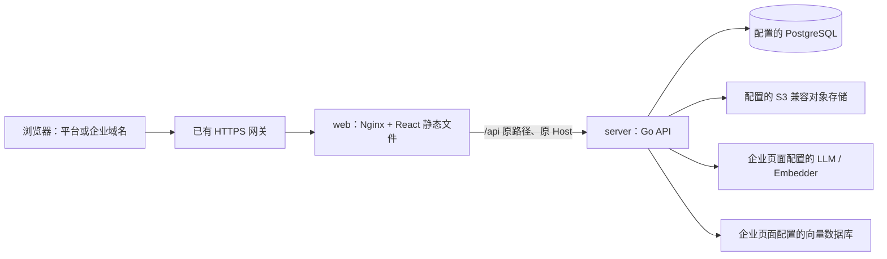

# Docker 部署

部署包含 `server` 和 `web` 两个应用容器，uniapp 不参与。PostgreSQL 和 S3 兼容对象存储通过配置连接，Compose 不创建、重建或清理这些外部服务。Go 使用多阶段构建，React 由 Node 构建后交给 Nginx 提供静态文件，运行时没有 Node 或 Vite 开发服务器。



同一份 Web 镜像服务所有企业域名，前端默认请求同源 `/api`，无需为每家企业重新构建。企业身份仍由后端根据原始 Host 查询；客户端不能通过请求头指定企业。

## 准备配置

需要 Docker Engine 及 Docker Compose v2+，使用 Linux 容器。以下命令都在仓库 `deploy` 目录执行：

```powershell
Copy-Item .env.example .env
```

编辑 `.env`，填写实际数据库连接、平台域名、S3 地址、桶及专用 AK/SK。该文件已被忽略，不进入镜像或版本控制；Compose 只把服务端配置传给 server，Web 不接收数据库或 S3 凭据。默认镜像构建上下文分别限定在 server 和 react-app，各自 `.dockerignore` 排除本地配置和构建产物。

| 参数 | 说明 |
| --- | --- |
| `DATABASE_URL` | 已存在的 PostgreSQL 16+ 数据库连接；密码中特殊字符须 URL 编码 |
| `PLATFORM_HOSTS` | 平台管理域名，逗号分隔，不包含协议、端口或路径 |
| `S3_ENDPOINT` | S3 兼容服务地址；AWS S3 可留空并配置对应 region |
| `S3_REGION`、`S3_BUCKET` | 区域和预先创建的私有桶 |
| `S3_ACCESS_KEY_ID`、`S3_SECRET_ACCESS_KEY` | 限定桶权限的服务端凭据 |
| `S3_USE_PATH_STYLE` | MinIO 通常为 true，按服务商要求配置 |
| `WEB_BIND_ADDRESS`、`WEB_PORT` | 宿主机发布地址与端口，默认只监听 `127.0.0.1:8088` |
| `IMAGE_TAG` | 本地构建镜像标签；发布时建议使用版本号或提交号 |

**容器里的 localhost 是容器自身。** 连接同机已发布端口的数据库和 MinIO 时，Docker Desktop 可使用示例中的 `host.docker.internal`；Compose 也为 Linux 配置了 `host-gateway` 映射，目标服务还须允许该地址访问。连接远程服务时直接填写其可达 DNS/IP。已有容器若通过共享网络连接，使用容器 DNS 名与容器内端口；MinIO 内部端口是 9000，本机宿主机发布端口是 9002，两者不能混用。示例没有自动加入其他 Compose 项目的私有网络。

## 初始化和启动

1. 数据库必须已经存在。空数据库先按 [数据库说明](../db/README.md) 执行一次 `db/saas.sql`；已有 SaaS 数据库不要重复导入。应用启动只检查表是否就绪，不自动建表或覆盖数据。
2. S3 模式先在对象存储服务创建私有桶及专用凭据；应用不自动建桶。当前本机已有 `agent` 桶，可使用已有专用凭据配置新容器。
3. 构建镜像：

```powershell
docker compose config --quiet
docker compose build
```

新环境没有平台管理员时，临时传入初始化凭据，复用 server 镜像执行一次初始化。PowerShell 示例通过凭据提示读取密码，避免将实际密码写进命令或 Compose 配置：

```powershell
$adminCredential = Get-Credential -Message '设置首位平台管理员'
$env:BOOTSTRAP_USERNAME = $adminCredential.UserName
$env:BOOTSTRAP_PASSWORD = $adminCredential.GetNetworkCredential().Password
try {
    docker compose run --rm --no-deps -e BOOTSTRAP_USERNAME -e BOOTSTRAP_PASSWORD server bootstrap
} finally {
    Remove-Item Env:BOOTSTRAP_USERNAME, Env:BOOTSTRAP_PASSWORD
    Remove-Variable adminCredential
}
```

已有平台管理员时跳过初始化，避免把 bootstrap 当作重置密码入口。启动服务：

```powershell
docker compose up -d --wait
docker compose ps
docker compose logs --tail=100 server web
```

本地平台入口为 `http://platform.localhost:8088/platform`（示例 PLATFORM_HOSTS）。平台开通企业后，用对应企业域名访问同一端口。生产环境将平台域名和各企业域名指向 HTTPS 网关，网关再转发至 Web。server 的 8080 不直接发布到宿主机。

server 的健康检查调用 `/api/health`，验证进程和数据库，不代表 S3 已完成读写验收；Web 的 `/healthz` 检查静态服务器。Web 首次启动等待 server 健康，两个服务均以非 root 用户运行，支持停止信号和优雅关闭。健康状态异常本身不会使 Docker 自动重启进程；`restart` 策略处理的是进程退出。

## 本地子域名与 HTTPS 网关

本地可使用 `platform.localhost` 作为平台入口，使用 `alpha.localhost`、`beta.localhost` 等不同子域名作为企业入口，它们都访问 `127.0.0.1:8088`。Chrome、Edge 等浏览器将 `.localhost` 解析到本机；系统或客户端不支持时，可在 hosts 文件添加对应域名到 `127.0.0.1` 的映射。平台中登记的企业 hostname 只填域名，不含协议和端口。

| 本地地址 | 用途 |
| --- | --- |
| `http://platform.localhost:8088/platform` | 平台管理入口 |
| `http://alpha.localhost:8088/` | 企业 alpha 的聊天首页、知识库和设置 |
| `http://beta.localhost:8088/` | 企业 beta，用于验证跨企业隔离 |

微信真实登录及原生资料能力留到线上环境验证，本地先验收 Web 的企业、账号、权限、资料和会话流程。

生产 HTTPS 证书和域名入口由现有网关维护，网关保留原始 Host。以宿主机 Nginx 为例，以下 location 放入已有 HTTPS server 块：

```nginx
location / {
    proxy_pass http://127.0.0.1:8088;
    proxy_set_header Host $http_host;
    client_max_body_size 11m;
    proxy_read_timeout 150s;
    proxy_buffering off;
}
```

网关位于另一容器时，需提供可达的网络路径并相应调整发布地址；默认的宿主机回环绑定不会向其他主机开放。

Web 保留 `/api` 前缀及原始 Host，业务 API 不缓存，头像的 HEAD/Range 与后端缓存头正常传递。知识资料最大 10 MiB，代理放行 11 MiB 以容纳 multipart；头像仍由 API 限制为 2 MiB，普通 JSON 仍有独立读取上限。哈希静态资源长期缓存，index.html 每次重新验证，React Router 的页面刷新回退到 index.html；缺失 API 或 `/assets/` 资源不会回退成页面。

## 知识库外部服务

向量目录参考两个项目的页面选项提供 13 个远程引擎模块，连接字段由引擎定义，全部通过企业页面配置。向量引擎作为外部服务连接，不随本项目 Compose 启动；向量索引可重建，业务权威记录保存在 PostgreSQL，资料原件通过 S3 保存。

企业管理员在“LLM 对话模型”“嵌入器 Embedder”“向量数据库”和“AI 默认设置”页面配置服务与新建模板，不写入前端环境变量或 Compose。服务商预设可填入地址和模型候选，也可以获取模型列表、实际测试调用及检测向量维度；预设不代表已经部署模型或拥有访问密钥。聊天需要在 LLM 模型列表启用一个可用模型；切换后所有新旧会话的下一条消息使用它，正在流式的请求保留开始时模型。关键词知识库可以直接处理资料，向量索引还需要真实 Embedder 与所选向量引擎。文件解析、格式限制和操作入口见 [知识库说明](../docs/knowledge.md)。这些服务独立部署，默认 Compose 仍只有 server 与 web。

页面里的服务地址由 **server 容器**访问，同机服务使用 `host.docker.internal` 或已连通的容器 DNS；浏览器能访问某地址不代表 server 可达。已有授权配置接口返回模型 API Key、完整向量连接配置和平台微信 AppSecret，供表单原值回填；保存按提交完整替换，不继承旧凭据，空值按字段规则校验。它们不进入静态包、未授权公开接口、浏览器持久化或日志；部署数据库与 S3 凭据仍只由服务端使用。生成最多等待两分钟，Web 已关闭 SSE 代理缓冲并放宽读取超时；外部网关也须采用上面的流式转发配置。

`db/saas.sql` 是当前完整结构，供空数据库初始化。已有库须先比对实际表结构，再执行对应的结构调整，不能重复导入完整 SQL，也不能只截取“新增表”：本次配置与聊天设计还涉及模型表重命名、知识库处理配置、分块标题上下文和旧向量清理记录的转换。升级时先停止 server，事务中完成结构调整，再启动新版本并验证健康状态和已有数据；不清空公司、账号、资料或对象存储。

## 改用文件存储

默认部署使用 S3，不为头像挂本地卷。若选择 filesystem，叠加对应文件：

```powershell
docker compose -f compose.yaml -f compose.filesystem.yaml up -d --build --wait
```

该配置将存储设为 filesystem，并把 `/data/objects` 挂到命名卷 `objects`。后续操作需带同样两个 `-f`。切换配置不会迁移已有对象，已有头像需要先按原 key 迁入目标存储。不要删除仍在使用的对象卷或外部私有桶。

## 更新和停止

```powershell
docker compose up -d --build --wait
docker compose down
```

更新会重建应用镜像和容器，不重新导入 SQL，也不重置平台账号。停止只移除本项目应用容器和应用网络，不操作已有 PostgreSQL、MinIO。新增表结构时应另行明确升级方式，不能对已有库直接重复执行完整建表 SQL。
