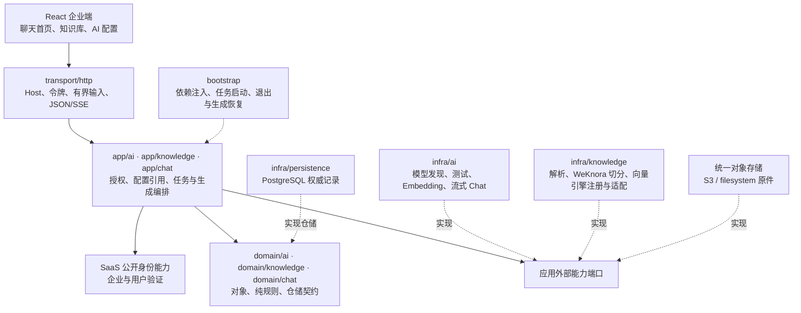

# AI 配置、知识库与聊天

企业端以聊天为首页，知识库单独管理资料。AnythingLLM 用于参考配置和交互，WeKnora 用于参考 Go 底层实现并复用切分算法；本项目继续使用已有 SaaS 身份、四层结构和统一对象存储，不引入新的 Workspace、FAQ/Wiki、Agent 框架、公有／私有知识库或 uniapp 页面。

## 配置后开始使用

1. 企业管理员进入“LLM”，选择服务商预设，填写实际凭据和模型；可发现模型、手填目录外模型，并使用当前表单测试。保存后在模型列表“启用”一项 LLM，作为企业所有对话下一次发送使用的模型。进入“Embedder”配置文本向量模型，检测实际输出维度。
2. 在“向量存储”搜索并选择引擎卡片，按该引擎表单填写连接并测试。在“默认配置与提示词”按需要编辑对应摘要项：默认 Embedder 与向量连接、System Prompt、生成参数、知识检索、文本分割与解析。每组独立打开、保存或取消。
3. 新建知识库，使用企业默认参数，必要时在高级设置调整。上传或输入资料，待处理完成后查看分块并使用检索测试确认来源。
4. 进入聊天，按需选择知识库并发送问题，聊天页不再选择模型。未选择知识库时是普通模型对话；选择后先检索资料，再生成带来源的回答。历史对话可以重新打开，引用内容随消息保存。

没有配置模型时，界面提供配置引导，不提供虚假可调用连接。服务商预设包含名称、Logo、能力、默认地址、模型候选及发现支持，不代表服务已部署或账号已有调用权限。页面按名称和描述搜索目录；具体服务商和可用用途以 `/api/ai/providers` 为准，不在前端维护另一份品牌清单。OpenAI 兼容协议使用 `/chat/completions`、`/embeddings`，Ollama 使用 `/api/chat`、`/api/embed`，服务商特殊路径或参数由其定义与驱动处理。没有模型发现接口时保留候选与手填，不显示不可用的发现操作。

预设按 Go 模块组织：服务商定义和品牌资源位于 `server/internal/infra/ai/providers`，显式注册目录将定义关联至实际协议驱动。Prompt、切分参数方案与已有策略元数据位于独立的 `server/internal/infra/ai/presets` 包，通过专用产品预设目录提供；模型 Registry 不承担模板职责。bootstrap 明确创建并注入各只读目录；领域不识别品牌，业务只依赖统一端口。新增兼容服务商不需要修改聊天、知识库或前端页面。向量模块位于 `infra/knowledge`，统一注册预设、Logo、字段、校验和实际驱动；页面只读取目录和字段。

产品预设接口包含 `prompts`、`chunking` 和 `chunk_strategies`，默认配置和知识库表单直接读取策略名称、说明和选项。Prompt 及切分方案按分类独立维护；目录构造时检查重复标识、内容、参数和方案引用，返回列表独立复制。算法实现与参数预设各自维护，新增参数组合不代表新增算法。

服务由 API 进程访问。Docker 中 `localhost` 指向 server 容器；同机外部服务应使用可达的 `host.docker.internal` 或容器 DNS。连接从页面保存，不要求修改部署文件中的模型环境变量。已有读权限的企业配置接口返回实际 `api_key` 并回填表单；保存、发现和测试均使用当前完整表单，不通过已存 ID 回读密钥。保存按提交值完整替换，空字符串直接清空；必填凭据为空时拒绝。凭据不写入静态包、浏览器持久化或日志，企业隔离和接口原有读写权限保持不变。

## 向量引擎模块

当前注册 13 个远程向量引擎模块，连接由企业在页面配置。

| 页面选择 | 适配方式 | 连接要点 |
| --- | --- | --- |
| Qdrant | REST | 地址、API Key、集合前缀 |
| Chroma / Chroma Cloud | 同一 Chroma v2 REST 驱动 | tenant、database、集合与认证 |
| Milvus / Zilliz Cloud | 同一 Milvus v2 REST 驱动 | 服务地址、token、database、集合 |
| Pinecone | Data Plane REST | 已建 dense cosine 索引的 Host、API Key、namespace |
| Weaviate | REST 与 GraphQL | 地址、API Key、Collection 前缀 |
| AstraDB | Data API | endpoint、token、namespace、collection |
| PGVector | pgx / PostgreSQL SQL | host、port、database、账号、schema、table；需安装 vector 扩展 |
| Elasticsearch / OpenSearch | REST | 地址、认证、索引前缀；OpenSearch 需 k-NN 插件 |
| Tencent VectorDB | 官方 HTTP API | 地址、账号、API Key、database、collection |
| Doris | MySQL 协议 / SQL | host、port、database、账号、table；需支持 ARRAY 与 cosine_distance |

连接接口使用 `{name,provider,config}`，config 的值统一为字符串；数字与布尔值在驱动边界解析。模块元数据声明必填、敏感输入、默认值及不可变字段，页面无需认识品牌。已授权配置响应返回完整 config，包括凭据；`secret` 元数据用于密码输入与默认值约束，不承担响应过滤。引用状态通过 `referenced` 提供。未知键、null、非字符串和不满足实际协议的配置均被拒绝。

所有连接字段按提交的 config 完整替换，不合并旧值或继承旧凭据；空串直接生效，必填字段缺失或为空时拒绝。被知识库、默认模板或旧索引清理任务引用的连接不能修改索引归属字段或删除。远端索引始终包含企业、知识库、资料与处理代元数据，命中后再由业务 PostgreSQL 复核；向量存储不成为资料的权威来源。

## 配置作用范围

| 配置 | 作用范围 | 修改后的行为 |
| --- | --- | --- |
| 企业启用 LLM | `ai_settings.chat_model_id` 记录唯一启用的 Chat 模型 | 新旧会话的下一条消息都使用它；正在生成的请求继续使用开始时捕获的模型 |
| 企业新建模板 | 默认 Embedder、向量连接、Prompt、生成、检索、解析和切分参数 | 只影响后续新建对象，不覆盖已有知识库或对话 |
| 知识库设置 | 当前库的索引、模型、连接、解析和切分 | 查询策略可直接改；已有资料的处理参数变更须确认重建 |
| 当前对话设置 | 当前会话的知识库、Prompt、生成及检索参数 | 保存后影响后续回答，不改写已有消息；模型由企业启用状态决定 |

初始参数为温度 0.7、最大输出 2048 token、历史 10 轮、混合检索、最多 6 个片段、向量相似度阈值 0、自动切分、每块 512 字符和重叠 80 字符。提供“通用知识助手／企业资料问答”Prompt 和“通用文档／长篇资料／Markdown 与章节资料”切分预设。模型和连接未配置时保持为空，不能用占位值冒充可用服务。

当前启用 LLM、默认 Embedder、知识库和待清理索引等真实引用保护配置不被删除；已引用模型的协议、地址、模型名和维度不能原地更换。`chat_sessions.model_id` 只记录服务端最近生成模型快照，不是会话配置，也不阻止删除旧模型。更换实际连接应新建配置，再显式切换；密钥可以更新。服务端在同企业事务协调中检查逻辑引用，防止删除配置和创建引用并发交错。

## 索引能力与检索策略

索引是导入资料时准备的数据，检索策略是提问时如何查这些数据，两者分别配置。

| 索引能力 | 导入时准备 | 可选查询策略 |
| --- | --- | --- |
| 关键词 `keyword` | PostgreSQL 中的正文与关键词索引 | 关键词 |
| 关键词与向量 `hybrid`，新库默认 | 关键词索引及真实 Embedder 生成并写入所选引擎的向量 | 关键词、语义向量、混合 |

关键词适合明确名称或术语，语义向量用于找含义相近的片段，混合合并两类结果。切换已有索引的查询策略不需要重新处理资料。关键词知识库是明确的高级选择；默认混合索引缺少 Embedder 或向量连接时会提示配置，不能静默改为关键词。

关键词查询保留英文全文和字面匹配；中文完整问句还按相邻双字片段召回、按匹配覆盖率排序，重复片段不重复计分。通常至少命中两个不同片段，双字短词允许一个，单字按字面检索。此能力只检索当前完成代的正文，不提供同义词或语义改写；中文匹配目前扫描本库有效分块，尚未持久化中文倒排索引。

检索分数只用于当前策略排序，不能把关键词权重、向量相似度和混合融合分数当作同一尺度。聊天中的相似度阈值只作用于纯向量检索。选择多个知识库时，各库都必须支持当前对话的查询策略；不支持时提示调整，不自动更换策略。

## 资料、分块与重建

支持 TXT、Markdown、CSV、JSON、DOCX、PDF 和手动正文。单文件最多 10 MiB，解析正文最多 2 MiB。文本、表格文本和 DOCX 在本地解析；PDF 需配置 WeKnora DocReader HTTP 地址。DOCX 只提取文字与表格，不执行宏或处理嵌入附件。原件使用现有 S3/filesystem 契约保存，下载需要同企业身份。

切分支持 `auto` 自动识别、`recursive` 递归和 `heading` 标题结构。页面可以粘贴正文预览分块，预览采用与后台相同的策略，但不保存文档、分块或向量。分块保留原文起止 Unicode 字符位置，标题层级单独保存在 `context_header`；向量化和问答使用标题上下文与正文，不改变原文范围。

资料依次显示等待、处理中、完成或失败。任务保存在 PostgreSQL，服务重启后可继续领取排队或租约过期任务；`attempt` 处理代阻止旧任务提交覆盖新结果。处理失败保留原件，可修正服务后重试。编辑分块会重新建立索引，完成前退出检索；重新处理原文会覆盖人工分块编辑。

已有资料时，更换索引能力、Embedder、向量连接、解析地址、切分策略、长度或重叠量需要“保存并重建全部文档”并确认。重建保留原件，原子更新配置、失效旧处理代并排队；新处理完成前相应资料不参与检索。存在处理中或清理中的资料时拒绝重建，避免新旧任务交错。旧向量清理目标保留原 `store_id + attempt`，切换连接后仍从正确的旧连接回收，清理失败可恢复。

删除资料先退出检索，再清理原件、分块和向量。处理中的资料进入“清理中”，等待旧任务租约结束后回收；已删除或旧代向量即使暂留，也必须经 PostgreSQL 复核后才可能返回。删除知识库会逐项清理资料；外部服务失败时保留可重试状态，已经完成的删除不会回滚。

## 对话、流式生成与引用

对话和消息同时按企业及用户归属过滤，企业管理员不会自动取得其他成员的对话。生成前复核模型用途、知识库归属和查询能力。同一会话只允许一条生成，生成期间修改或删除会话返回冲突；其他用户或企业访问仍返回 404，不通过生成冲突暴露会话状态。网络调用不持有数据库长事务。

每次发送都读取企业当前启用的 LLM，旧会话也使用新启用的模型。请求开始时捕获完整模型配置，之后切换启用状态或修改连接不会改变本次流式请求。会话输入不接受 `model_id`；输出的 `model_id` 只是最近生成时由服务端更新的只读快照，不能用它恢复或指定后续调用模型。尚未启用 LLM 时，发送明确提示配置。

聊天沿用标准应用框架，保留侧边文字导航和顶部栏，在页面内容区的卡片内提供本用户历史与聊天。用户消息气泡靠右、头像位于气泡右侧；AI 回答靠左、头像位于正文左侧。用户正文仍左对齐，保留输入换行，长文字与 URL 自动换行；AI 的代码块和表格在内容内部横向滚动，不撑宽页面。历史恢复、流式生成和窄屏使用相同的角色排布。

空对话的输入框位于聊天卡片中央，出现消息后位于卡片底部；Enter 发送，Shift+Enter 换行，中文输入法选字期间不会误发送。历史和流式回答统一安全渲染 Markdown，回答提供复制操作，来源在抽屉中查看。只有接近底部时跟随新内容滚动，向上阅读历史时不会被新 token 拉回底部。

点击“新建对话”会立即失效旧创建、加载和流式请求，即使操作前后 URL 都是 `/`。过期创建结果不能跳回已放弃的会话或继续发送，旧响应不能污染新对话；已提交写入仍以服务端记录为准。

发送先保存用户消息及生成中的助手消息，再推送 SSE。事件依次为 `message`、`sources`、`delta`，最后为 `done` 或 `error`；连接开启前失败仍返回 JSON 错误。停止生成会取消上游并保存已有文本，失败或断流同样保留部分回答和明确状态。客户端连接异常后应重新读取服务端结果，取消等待不代表数据库回滚。当前单服务启动时把中断的生成标记为失败，避免永久显示生成中。

回答引用保存本轮的资料标题、分块内容、知识库与资料 ID、分数等快照。后续资料修改或删除不改写历史引用。选定知识库但无命中时，回答明确显示“未在所选知识库中检索到相关资料”，不伪造来源。只有完整完成的问答轮次进入后续历史。

普通消息最多 16,000 个 Unicode 字符；使用知识库时问题最多 2,000 个字符。引用正文按每段 8,000 字符、合计 32,000 字符的预算截取，并另附截断说明。历史使用总计 60,000 字符扣除提示词、资料及当前问题后的剩余预算，只保留完整轮次。该字符预算不等于模型 tokenizer 的精确 token 计数。

## 四层职责与来源

PostgreSQL 保存业务权威数据，向量数据库只保存可重建索引。跨模块通过公开能力或消费方端口协作，不直接操作另一模块私有仓储。逻辑关联由应用事务维护，不建立数据库外键。WeKnora 切分源码保留 MIT 许可及来源说明；不全量迁入其身份体系或历史兼容逻辑。

## HTTP 接口

以下均为已有 Bearer 登录身份，企业从 Host 与会话核实，不接受客户端 `tenant_id`。完整数据结构见 [接口契约](../openspec/changes/implement-document-knowledge/contracts.md)。

| 路径 | 操作 |
| --- | --- |
| `GET /api/ai/providers`、`GET /api/ai/presets` | 服务商、Prompt、切分预设 |
| `GET /api/knowledge/vector-providers` | 已注册向量引擎、Logo、连接字段及默认值 |
| `GET/POST /api/ai/models`、`PUT/DELETE /api/ai/models/:id` | Chat 与 Embedding 配置 |
| `PUT /api/ai/models/:id/activate` | 无请求体，启用本企业 Chat 模型并返回完整 Settings；仅企业管理员可操作 |
| `POST /api/ai/models/discover`、`POST /api/ai/models/test` | 使用当前表单中的服务地址、模型与 api_key 发现和测试，不接受已存 ID 回读凭据 |
| `GET/PUT /api/ai/settings` | 读取和保存企业新建模板；响应含只读 `chat_model_id`，保存输入不含该字段，也不覆盖当前启用 LLM |
| `/api/knowledge/vector-stores`、`/:id`、`/:id/test` | 向量连接列表、创建、更新、删除及测试 |
| `/api/knowledge/bases`、`/bases/:id` | 知识库列表、创建、详情、更新及删除 |
| `POST /api/knowledge/preview`、`POST /api/knowledge/bases/:id/rebuild` | 无写入切分预览、确认整库重建 |
| `/api/knowledge/bases/:id/documents`、`/upload`、`/search` | 资料列表与输入、文件上传、检索 |
| `/api/knowledge/documents/:id`、`/download`、`/reprocess`、`/chunks` | 资料详情与修改删除、下载、重处理、分块 |
| `PATCH /api/knowledge/chunks/:id` | 编辑分块并重新索引 |
| `GET/POST /api/chat/sessions`、`GET/PUT/DELETE /api/chat/sessions/:id` | 本用户会话列表、创建、详情、更新及删除 |
| `GET/POST /api/chat/sessions/:id/messages`、`POST /api/chat/sessions/:id/stop` | 消息历史、SSE 生成及停止 |

知识库和向量连接的表单更新使用 PATCH，提交完整业务表单；模型、企业默认值使用 PUT。会话输入不含 `model_id`，其他允许省略字段在创建时复制默认值、更新时保留已有值；显式 `null` 一律拒绝。旧 `/api/knowledge/models` 不再保留，模型统一归 `/api/ai/models`。

数据库与中文注释 ER 见 [数据库说明](../db/README.md)，运行方式见 [服务端说明](../server/README.md)，代理与连接配置见 [部署说明](../deploy/README.md)。

## 验证方式与范围

后端执行 `go test ./...`、`go vet ./...`；真实业务集成显式使用 `SAAS_TEST_DATABASE_URL`，在随机 schema 导入完整结构并回收。回归范围包括配置权限与隔离、模板快照、引用保护、资料生命周期、切分与重建、会话归属、生成中跨用户和企业仍返回 404、来源保存、失败、停止、并发生成和中断恢复；模型启用还须验证新旧会话下一条消息切换、流式请求固定开始时模型、保存模板不覆盖启用状态，以及旧模型仅剩历史快照时可删除。

真实向量生命周期按测试环境显式启用：Qdrant、Chroma、Weaviate 分别使用 `TEST_QDRANT_ENDPOINT`、`TEST_CHROMA_ENDPOINT`、`TEST_WEAVIATE_ENDPOINT`。PGVector、Doris 分别通过 `TEST_PGVECTOR_CONFIG`、`TEST_DORIS_CONFIG` 接收与页面 config 相同的字符串 JSON 对象。用例创建并清理独立集合或 schema，验证写入、检索、企业及处理代隔离和删除。缺少对应配置时跳过，不能算真实引擎验证通过。

其余云端及 HTTP 驱动使用按官方契约构造的协议测试，覆盖字段、批次、部分写入、无效响应、取消、清理范围和跨企业结果拒绝；这不能代替实际服务连通验收。Doris 与 Elasticsearch/OpenSearch 当前使用原生精确 cosine 查询，未声称提供 ANN 性能。

React 执行 `npm test`、`npm run build`、`npm run lint`；`npm run test:e2e` 从真实界面贯通 Go API 与隔离 PostgreSQL，保留 SaaS 回归，并覆盖配置、知识库和对话流程。聊天交互回归包括空态与底部输入切换、Enter 与中文输入法、Markdown 与复制、来源抽屉、上滚阅读和同 URL 新建对话的旧请求失效；在桌面、刷新恢复及 390px 窄屏下通过实际元素位置验证用户右、AI 左和头像顺序，并检查用户长文本与长链接不撑宽消息区。模型协议测试及自动流程可使用受控 HTTP 模型上游，不能因此宣称真实模型效果已经验收；真实 Qdrant、实际模型、PDF DocReader 和微信分别说明是否执行，未配置依赖的跳过也必须明确报告。
