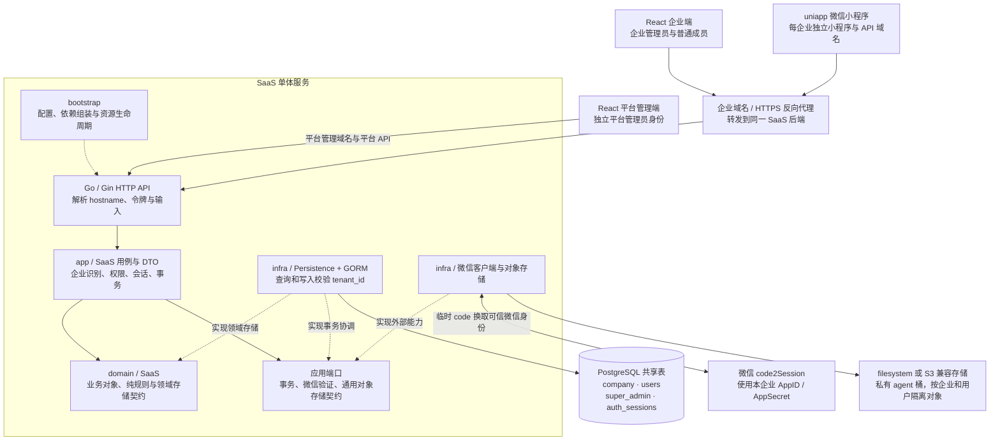

# SaaS 设计与接口

本文说明平台、企业、账号与登录会话管理。文档知识库与聊天复用此身份基座，模型及向量连接由企业管理员在页面配置，见 [知识库与聊天说明](knowledge.md)。FAQ、公有／私有及小程序知识库入口尚未实现。

## 业务规则

- 一个企业对应一个 tenant，由访问域名识别；一个用户固定归属一家企业，不存在跨企业成员关系或切换企业。
- 企业管理员与普通成员共用 `users`，角色为 `admin / user`。平台管理员使用独立的 `super_admin`，平台与企业令牌不能通用。
- 平台负责开通企业及首位管理员、调整企业设置和启停、重置企业管理员密码。企业管理员负责成员管理；Web 只提供账号密码登录，成员账号由管理员创建。
- 企业必须至少保留一名正常管理员。开通企业与首位管理员在同一事务完成，并发降权或停用不能破坏此规则。
- 用户可修改昵称、头像和密码，用户名不可修改，不提供物理删除入口。小程序提供微信头像选择与昵称填写能力，头像上传后持久保存。
- 微信登录即登录／注册，首次自动创建本企业普通成员；后续恢复同一成员，不增加强制完善资料步骤。
- 微信身份按企业、AppID、OpenID 关联账号，不使用昵称或头像合并现有用户名账号。首次创建使用每账号独立随机初始密码，只保存散列；小程序设置页验证新微信 code 后可设置新密码，复登不覆盖密码。
- 平台在企业管理中维护该企业的 AppID、AppSecret；配置直接保存在 `company.app_id / app_secret`，AppSecret 为数据库明文，运行时动态读取。没有独立配置表或微信启用开关，企业换域名保留配置。平台授权配置接口返回 AppID 与 AppSecret 原值，保存完整提交两项有效值，不继承旧密钥。
- 停用、密码变更、密码重置或权限变化会撤销相应会话；重新启用不能恢复旧令牌。

## SaaS 架构

企业域名选择租户，账号、角色和服务端校验决定访问权限。各企业共享服务与数据表，企业数据通过 `tenant_id` 隔离；平台管理员身份独立。表间使用逻辑关联，由 Go 在事务内验证。

物理表名采用 `company / users / super_admin / auth_sessions`。业务层仍使用 tenant 表达租户，`users.tenant_id` 与企业会话的 `tenant_id` 逻辑关联 `company.id`；HTTP 路径、DTO 名称和字段保留现有 tenant 契约。微信身份直接保存在用户的 `wechat_app_id / open_id`，不再使用独立映射表。

微信登录链路为 `uni.login → 临时 code → 本企业 API → 微信身份验证 → 本企业用户 → SaaS Bearer 会话`。微信验证由服务端使用 AppSecret；仅平台授权配置接口回显它，公共站点、用户资料和微信登录接口不返回 AppSecret，微信临时 `session_key` 也不下发客户端；后续业务请求统一使用本系统令牌。

当前运行链路使用 PostgreSQL，上传对象可选择本地文件或 S3 兼容存储（包括 MinIO）。React 已接入知识库、RAG 和聊天，复用 WeKnora 切分实现并参考 AnythingLLM 配置与对话交互；未运行这两个示例项目的完整服务，也未引入 Redis。知识处理及聊天在独立能力模块中消费现有 SaaS 身份。

## 实现结构

| 位置 | 职责 |
| --- | --- |
| `server/cmd/api/main.go` | API 进程入口、退出信号与错误退出 |
| `server/internal/bootstrap` | 配置加载、依赖组装、平台初始化、HTTP 服务与连接生命周期、清理调度 |
| `server/internal/domain/saas` | 业务对象、错误、纯规则及领域存储契约，不依赖其他层 |
| `server/internal/app/saas/usecase` | 认证、账号、企业、站点、维护与初始化用例，负责权限、事务与锁序 |
| `server/internal/app/saas/dto` | 用例输入与输出、分页及 API 字段契约，与领域对象显式映射 |
| `server/internal/app/saas/port` | 事务协调、微信验证等用例所需契约 |
| `server/internal/app/storage` | 应用公共对象存储契约，不包含头像业务 |
| `server/internal/infra/persistence/saas` | 实现领域存储与应用事务契约，管理私有模型、企业范围查询与映射 |
| `server/internal/infra/database` | GORM PostgreSQL 连接与建表就绪检查 |
| `server/internal/infra/wechat` | 通用 code2Session 协议客户端、应用端口适配、超时和脱敏错误 |
| `server/internal/infra/storage` | 通用对象存储工厂及 filesystem、S3 兼容实现 |
| `server/internal/transport/http` | Gin 路由、输入、响应与中间件，消费所需业务能力接口 |
| `react-app/src/App.tsx`、`router`、`layouts` | 应用组装、路由权限入口与应用布局 |
| `react-app/src/pages` | 完整页面及其专属表单、交互、样式与测试 |
| `react-app/src/api` | fetch 请求层、按业务组织的接口、类型与响应解码 |
| `react-app/src/stores/session` | Zustand 会话及持久化、身份契约与 Hook |
| `react-app/src/components`、`hooks`、`utils` | 跨页面组件、Hook 与用途明确的公共函数 |
| `uniapp/src/pages/index` | 完整账号页面、平台生命周期、页面状态、校验与私有组件 |
| `uniapp/src/api` | uni.request / uni.uploadFile、会话存储、账号接口及响应契约 |

后端采用 `domain / app / infra / transport` 四层，各层内部按业务能力组织，由 `bootstrap` 创建并注入依赖。`transport → app → domain`，`infra` 实现领域和应用定义的消费方契约；领域不依赖其他层，也不携带 JSON 或 ORM 标签。应用用例通过 DTO 与 HTTP 协作，负责事务、锁序和跨操作编排；领域维护独立于数据库的规则。用例不导入 GORM、文件系统、S3 SDK 或具体微信客户端，HTTP 不创建业务或基础设施。`bootstrap.New` 使用调用方提供的数据库但不关闭它；运行入口管理连接生命周期，测试通过相同装配入口创建处理器。

头像用例负责图片校验、对象 key、企业与用户归属，通过应用公共 `storage.Store` 保存、读取、检查和删除对象。基础设施实现只处理通用对象操作，可通过配置切换 filesystem 与 S3 兼容服务，业务不绑定 MinIO。S3 使用预先创建的私有 `agent` 桶，服务端凭据仅留在部署配置；浏览器和小程序通过稳定的 `/api/avatars/:tenant/:user/:file` 读取图片。数据库仍保存该相对地址，不保存对象服务地址或会过期的预签名 URL。切换存储不自动迁移已有对象，配置方式见 [服务端对象存储](../server/README.md#对象存储)。

前端路由组合完整页面与布局，页面调用 API、Store 与公共组件，公共能力不反向依赖页面或路由注册模块。请求层通过明确参数和回调接入身份，不能反向导入 Store。uniapp 页面控制器不依赖 Vue 实例，平台请求和存储通过客户端适配。

数据库使用唯一的完整建表文件 [db/saas.sql](../db/saas.sql)，在空 PostgreSQL 业务数据库执行一次。只包含当前 SaaS 的四张表，不使用增量脚本或 AutoMigrate。表间关系由 Go 校验，保留主键和业务唯一索引，不建立数据库外键、CHECK、数据库枚举、触发器或 RLS。字段说明和带注释的 ER 图见 [数据库说明](../db/README.md)。

## Web 路由

React Router 管理 URL，导航、刷新、直接访问与浏览器前进后退使用同一套路由定义。

| 路径 | 页面及权限 |
| --- | --- |
| `/login` | 企业账号登录 |
| `/` | 企业工作台 |
| `/account` | 企业成员个人账号 |
| `/members` | 企业管理员的成员管理 |
| `/settings` | 企业管理员的企业设置 |
| `/platform/login` | 独立平台管理员登录 |
| `/platform` | 平台工作台 |
| `/platform/tenants` | 平台企业管理 |
| `/platform/account` | 平台管理员账号 |

应用先通过 `/api/site` 获取当前域名的站点类型。平台域名开放平台入口，企业域名开放企业入口，未知域名显示未绑定；已绑定的停用企业仍返回企业身份与停用状态，页面提示停用并禁止登录。企业域名访问 `/platform` 被拒绝。未登录访问受保护页面时跳转对应登录入口，登录后恢复目标页面。服务端同时校验域名、账号权限与会话，菜单和前端路由不代替授权。

## HTTP 通用契约

- 前缀为 `/api`。成功响应为 `{ "data": ... }`，失败为 `{ "error": { "code": "...", "message": "中文说明" } }`。ID 是正十进制字符串，时间使用 RFC3339。
- 企业由 HTTP Host 识别。Go 规范为小写并去掉端口，拒绝协议、路径和非法域名；不接受客户端指定企业 ID 或用 `X-Tenant-Hostname` 覆盖入口。认证还需匹配有效企业、账号与会话。
- 小程序配置本企业 API URL；反向代理及本地开发代理保留 Host。平台管理域名通过部署参数 `PLATFORM_HOSTS` 指定，不能绑定为企业域名。
- `Authorization: Bearer <token>`。随机令牌只在签发时返回，数据库仅存 SHA256 摘要。会话绝对有效期为 7 天。
- 写入 JSON 必须是单个对象，最大 16 KiB；拒绝未知字段和字段 `null`。部分更新至少提供一个可写字段，缺省保留，显式空字符串按字段规则处理。
- 用户名为 3–64 个 ASCII 字母、数字、下划线、点或横线，统一小写。密码按 UTF-8 校验 10–72 字节，不做 trim。昵称最多 64 个 Unicode 字符；头像为空、本用户已上传的受控相对路径或 HTTP(S) 地址，最多 2048 字节。
- 状态为 `active / disabled`，角色为 `admin / user`。仅服务端可写密码散列和身份归属，账号响应不包含密码散列或微信临时 session_key；已授权配置接口按其契约返回相应凭据，不扩大接口权限。
- 搜索分页为 `?q=&page=1&page_size=20`，page_size 最大 100。结果为 `{items:[],total:0,page:1,page_size:20}`。
- 错误按无效输入 400、认证失效 401、权限不足或停用 403、记录不存在 404、业务冲突 409、基础设施故障 500 区分。数据库故障不能当作账号失效；微信上游错误另按微信接口契约映射。

公开数据：

| 类型 | 字段 |
| --- | --- |
| Tenant | `id,name,hostname,status,created_at,updated_at` |
| User | `id,tenant_id,username,nickname,avatar_url,role,status,created_at,updated_at` |
| PlatformAdmin | `id,username,created_at` |

## 企业与个人接口

以下路径省略 `/api`。

| 方法和路径 | 请求及权限 | data |
| --- | --- | --- |
| GET `/site` | 无需认证，按请求域名识别入口 | `{kind,hostname,tenant?}`，kind 为 platform / tenant / unknown |
| GET `/tenant` | 无需认证 | Tenant |
| POST `/auth/login` | username、password | `{token,expires_at,user,tenant}` |
| POST `/auth/wechat/login` | code；后端按企业配置向微信验证，首次自动注册 | `{token,expires_at,user,tenant}` |
| GET `/auth/me` | 企业 Bearer | `{user,tenant}` |
| POST `/auth/logout` | 企业 Bearer | `{ok:true}` |
| PUT `/account/profile` | nickname、avatar_url 两项必填，完整保存；空串清空，缺字段拒绝 | User |
| POST `/account/password` | current_password、new_password | `{ok:true}`，全部会话失效 |
| POST `/account/wechat/password` | 企业 Bearer、code、new_password；微信身份必须对应当前用户 | `{ok:true}`，全部会话失效 |
| POST `/account/avatar` | 企业 Bearer；multipart file，PNG/JPEG，最多 2 MiB | `{avatar_url}`，持久化的本用户相对路径 |
| GET / HEAD `/avatars/:tenant/:user/:file` | 随机文件名的已上传头像；GET 支持 Range | 图片或元数据，非 JSON |
| GET `/admin/users` | 企业管理员，分页搜索 | User 列表 |
| POST `/admin/users` | username、password，可选 nickname、role（缺省 user） | User |
| PATCH `/admin/users/:id` | role、status 至少一项 | User |
| POST `/admin/users/:id/reset-password` | new_password | `{ok:true}`，该账号全部会话失效 |
| PATCH `/admin/tenant` | name 必填 | Tenant |

Web 与小程序均使用同一 PUT 资料接口，保存完整资料。企业管理的 PATCH 接口仅用于相应的部分字段更新。

微信登录只接受临时 `code`，不接受客户端指定 OpenID、AppID、企业 ID 或角色。微信凭据过期返回 `wechat_invalid_code`（401），微信拒绝当前账号登录返回 `wechat_login_blocked`（403），调用过频返回 `wechat_rate_limited`（429），企业未配置和上游不可用分别返回 `wechat_not_configured` / `wechat_unavailable`（503），无效上游响应返回 `wechat_upstream_error`（502）。这些错误与本系统 Bearer 会话失效分开处理。

## 平台接口

以下接口均使用独立平台身份，路径省略 `/api`。

| 方法和路径 | 请求 | data |
| --- | --- | --- |
| POST `/platform/auth/login` | username、password | `{token,expires_at,admin}` |
| GET `/platform/auth/me` | 平台 Bearer | `{admin}` |
| POST `/platform/auth/logout` | 平台 Bearer | `{ok:true}` |
| POST `/platform/account/password` | current_password、new_password | `{ok:true}`，平台账号全部会话失效 |
| GET `/platform/tenants` | 分页搜索 | Tenant 列表 |
| POST `/platform/tenants` | name、hostname、admin_username、admin_password | `{tenant,user}` |
| PATCH `/platform/tenants/:id` | name、hostname、status 至少一项 | Tenant |
| POST `/platform/tenants/:id/reset-admin-password` | username、new_password | `{ok:true}`，重置现有企业管理员并撤销会话 |
| GET `/platform/tenants/:id/wechat` | 平台 Bearer | `{app_id,app_secret}`，返回当前配置原值 |
| PUT `/platform/tenants/:id/wechat` | 平台 Bearer；app_id、app_secret 两项必填，缺失或空值拒绝 | `{app_id,app_secret}`，返回已保存原值 |

小程序配置没有启用字段。保存按当前表单完整替换 AppID、AppSecret，不继承旧值；两项均按字段规则校验，缺省、null 或空字符串拒绝。后台读取用于原值回填，配置草稿不写入浏览器持久化或日志。企业设置变更后配置仍归原企业；微信身份按 AppID 区分，不自动合并。

## 事务、状态与运行

请求体读取、纯校验和密码散列在写事务与业务锁前完成。常规企业请求持有企业共享锁，账号按读写选择共享或排他锁；企业生命周期和有效管理员数量变更通过企业排他锁串行。锁按平台身份→企业→企业账号的顺序获取，密码锁后重新核对凭据快照。会话通过数据库实际时钟检查，等锁不会延长有效期。

微信外部验证在事务和业务锁外完成；事务内复核同一企业、`company.wechat_config_version` 与正常状态，并对同一微信身份的并发首登串行化，确保只创建一个成员。微信身份字段与成员记录保存在同一行，首次成员和会话原子提交。AppSecret 直接存入 `company.app_secret`，后台变更后无需重启，也不配置加密主密钥；验证期间变更则拒绝旧快照并要求重新获取 code。微信改密核实当前用户的 `wechat_app_id / open_id`，不要求用户知道随机初始密码。

React 的 Zustand Store 拥有当前内存会话，通过 `persist` 与 `createJSONStorage` 只将令牌保存到当前标签页的 sessionStorage，平台与企业分别隔离。恢复数据按白名单校验，不能覆盖运行时动作；身份资料从后端重新确认，版本号、提示、表单和密码草稿不持久化。uniapp 客户端拥有令牌及存储，控制器拥有界面与草稿。身份改变会撤销旧请求归属并清空授权视图、资料与密码草稿；存储异常仍须完成内存状态失效并反馈原因。取消已发出的写入不能视为回滚，重新进入相关页面时读取服务端确认。

后端自动加载本地 `server/.env`，已有系统环境变量优先；缺少 .env 时仍可仅使用系统环境变量启动。后端读取 `DATABASE_URL`，默认监听 `:8080`；平台管理员由 bootstrap 命令写入 `super_admin`，没有默认密码。本地 .env 和初始化凭据不提交到仓库。生产使用 HTTPS 及同域反向代理，跨域时显式设置 `ALLOWED_ORIGINS`。SQL 日志关闭，服务日志只保留操作和脱敏故障类别。

安装、初始化与启动见 [服务端](../server/README.md)、[Web](../react-app/README.md)、[uniapp](../uniapp/README.md)。

## 验证入口

- Go：`go test ./...`、`go vet ./...`。真实 PostgreSQL 流程需显式指定 `SAAS_TEST_DATABASE_URL`，每个流程创建并清理自有随机 schema；真实 S3 对象与头像贯通另需 `TEST_S3_ENABLED=1` 及 `TEST_S3_*`，仅清理本次随机对象。
- React：`npm test` 使用 Vitest / React Testing Library；`npm run build`、`npm run lint`；`npm run test:e2e` 通过真实 API 和隔离 PostgreSQL 验证浏览器业务流程及路由。
- uniapp：`npm test` 使用 Vitest / Vue Test Utils；`npm run build:h5`、`npm run build:mp-weixin`。微信开发者工具调试直接连接编译目录，使用测试自有企业与账号验证平台事件、请求和存储。

组件测试隔离 HTTP 或平台适配，不能替代真实后端和目标平台验证。测试服务通过本次运行 ID 握手确定归属；启动与停止有期限，只回收本次拥有的资源。
